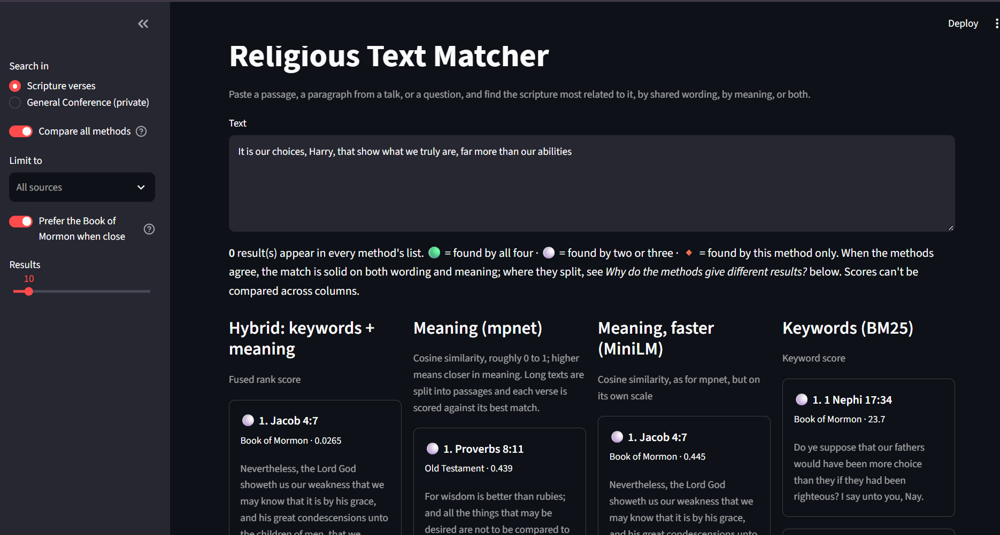

# Religious Text Matcher

Paste a passage, a paragraph from a talk, or a question, and find the scripture most related to it. Search runs over the King James Bible and the Book of Mormon, by shared wording, by meaning, or by both combined.

The goal is to find the scripture closest in *meaning* to a piece of text. The only large set of human judgments available, a crowd-voted list of Bible cross-references, mostly rewards shared *wording*. On it, keyword search beats the embedding models. In hands-on use, the meaning-based methods give the more useful matches. The evaluation below measures what it can and states plainly what it can't.



Write-up: [The benchmark said keywords. Using the tool said meaning.](https://kaydenrmaughan.github.io/writing/posts/religious-text-matcher/)

## Results

**Task 1: verse → related verses.** 2,000 held-out query verses, scored against OpenBible.info cross-references with at least 5 votes. Test split, run once after all tuning was done on a separate 2,000-query dev split.

| Model | nDCG@10 | Recall@10 (capped) | MRR@10 |
|---|---|---|---|
| BM25, stemmed (k₁ 0.4, b 1.0, tuned on dev) | 0.215 | 0.233 | 0.354 |
| MiniLM (`all-MiniLM-L6-v2`) | 0.163 | 0.177 | 0.282 |
| mpnet (`all-mpnet-base-v2`) | 0.170 | 0.181 | 0.296 |
| **Hybrid: BM25 + mpnet, reciprocal rank fusion** | **0.226** | **0.250** | **0.364** |

The hybrid beats BM25 by +0.011 nDCG@10 (95% paired-bootstrap interval +0.004 to +0.019) and +0.018 capped recall (+0.008 to +0.027). Both gains hold at the 3-vote and 10-vote relevance cuts as well. Each embedding model on its own trails BM25 at every cut and on every metric, and every one of those intervals excludes zero.

**Why keywords win on this benchmark.** The labels are lexical. 47% of labeled pairs share a rare word, compared with 4% of random verse pairs. That's because the cross-references descend from a concordance-style 19th-century reference work. The embedding models were also trained on modern English, not KJV prose. On the links with no shared rare word, mpnet's recall is 2.3× BM25's, but every model is near zero there. The fair reading: on this benchmark, meaning-based retrieval adds signal *on top of* keywords rather than replacing them.

**In practice.** For the project's real goal, matching by meaning, the meaning-based methods (mpnet and the hybrid) return the more useful results in hands-on use, especially for modern-language text. That's an observation, not a measured result: no labeled set for meaning-level relevance exists here yet. The app defaults to the hybrid, which uses both signals and scored best on the benchmark, and lists keyword-only search last.

**Task 2: verse → related chapter (long documents).** The same queries against all 1,189 Bible chapters (median 627 words, well past the models' 256- and 384-token windows). A chapter counts as relevant if it holds a ≥ 5-vote target.

| Model | Truncated | Chunked + max-pool | Difference [95% CI] |
|---|---|---|---|
| MiniLM | 0.102 | 0.155 | +0.054 [+0.045, +0.063] |
| mpnet | 0.122 | 0.160 | +0.038 [+0.029, +0.047] |


(nDCG@10, votes ≥ 5.) For comparison, BM25 over whole chapters scores 0.264, and the hybrid (BM25 + chunked mpnet) scores 0.250, −0.014 [−0.024, −0.005] against BM25. Embedding a long document whole silently drops everything past the model's token limit. Splitting it into passages and scoring each document by its best passage fixes that, and the gain is large and consistent. BM25 leads on chapters by an even wider margin, though, and equal-weight fusion with a much weaker partner costs a little. The app uses the hybrid because verse search is its main use; the chapter result is the honest counterpoint.

**A private replication.** Chunking was also tested on a private set of talks, each scored against the scripture it cites, with the Doctrine and Covenants and Pearl of Great Price added so those citations resolve. That corpus can't be redistributed, so its results aren't published here.

## What it does

- **Three retrievers and a hybrid.** BM25 with Lucene IDF and a KJV-aware stemmer (`loveth` → `love`), two sentence-embedding models with exact cosine search, and reciprocal rank fusion of BM25 and mpnet.
- **Long text in, long text out.** Long queries and long documents are split into passages; a document scores as its best-matching passage.
- **Book of Mormon preference.** Many Book of Mormon chapters quote Isaiah or the Sermon on the Mount nearly word for word. A small boost (0.0006 in fused-score units, on by default for the hybrid) lets the Book of Mormon parallel edge out its source when the two are near-equal: Mosiah 14:3 ahead of Isaiah 53:3. It was sized on 445 aligned parallel verse pairs. It raises the Book of Mormon share of a typical top 10 from about 11% to about 12.6%, and it never reorders Bible verses among themselves, so the Bible metrics above are unaffected.
- **Corpus-agnostic.** Any collection in a simple JSON format can be loaded locally through a gitignored `config.local.toml` (see [docs/corpus-format.md](docs/corpus-format.md)).

Looking for which talks cite a particular verse? The [BYU Scripture Citation Index](https://scriptures.byu.edu/) catalogs that. This tool answers the reverse question: given any text, including text no index has seen, which scripture relates to it by content.

## Evaluation design

- **Labels:** [OpenBible.info cross-references](https://www.openbible.info/labs/cross-references/) (CC BY): 344,799 crowd-voted links, expanded to about 614,000 verse pairs. Relevance means ≥ 5 votes (primary), with 3 and 10 as robustness checks. Binary relevance is primary; vote-graded nDCG is secondary, because votes track popularity as well as relevance.
- **Splits:** two disjoint, seeded samples of 2,000 query verses, stratified by testament. Dev was used for every tuning choice (BM25 k₁ and b, tokenizer variant); test was run once.
- **Leakage:** the query verse is removed from its own candidates; self-links are dropped.
- **Book of Mormon results** carry no OpenBible labels. They're dropped from each ranked list before scoring (condensed lists, Sakai 2007), and their share of the top 10 is reported separately.
- **Uncertainty:** paired bootstrap over queries for every model comparison.

Full method notes are in [docs/methods.md](docs/methods.md), and the dated decision log is in [docs/decisions.md](docs/decisions.md).

## Limitations

- The labels favor shared wording, so they understate what embedding models add for paraphrase or modern-language queries. A sensible match the references don't list counts as a miss.
- Scores are relative ranking signals, not probabilities or measures of doctrinal relevance.
- The embedding models are general-purpose and were not fine-tuned on scripture.
- Fusion weights are equal and untuned. A weighted fusion might recover the chapter-task gap, but it wasn't tuned, to avoid fitting to a reported set.
- The Book of Mormon boost is a stated preference, not something the labels can validate.
- Study aid only; it carries no doctrinal authority. Don't paste private or sacred personal text into a hosted copy; run it locally instead.

## Data

| Source | Use | License |
|---|---|---|
| King James Version (Project Gutenberg #10) | Corpus | Public domain (US) |
| Book of Mormon (Project Gutenberg #17) | Corpus | Public domain (US) |
| OpenBible.info cross-references | Evaluation labels | CC BY |

`scripts/fetch_data.py` downloads the texts into `data/raw/` (gitignored) and records each file's URL, date and SHA-256. No corpus text is committed. The parser yields the standard 31,102 KJV and 6,604 Book of Mormon verses. All but 5 of the 344,799 cross-reference links join; those 5 point to 3 John 1:15, which this edition folds into 1:14.

## Run locally

```bash
python -m venv .venv && .venv/Scripts/activate   # Windows; use bin/activate elsewhere
pip install -r requirements.txt
pip install -e .
python scripts/fetch_data.py
streamlit run app/app.py
```

On Windows, after setup, `launch.bat` starts the app on port 8520 (a desktop shortcut to it works too).

To reproduce the evaluation: `python scripts/run_eval.py --split test` (verse task), `python scripts/run_chapter_eval.py` (chapter task) and `python scripts/boost_parallels.py` (boost sizing). The first run embeds the corpus and caches the vectors.

## Stack

Python · sentence-transformers · NumPy · pandas · Streamlit · pytest (146 tests)

## License

Code: MIT. Corpus texts and evaluation data keep their own licenses (above).
